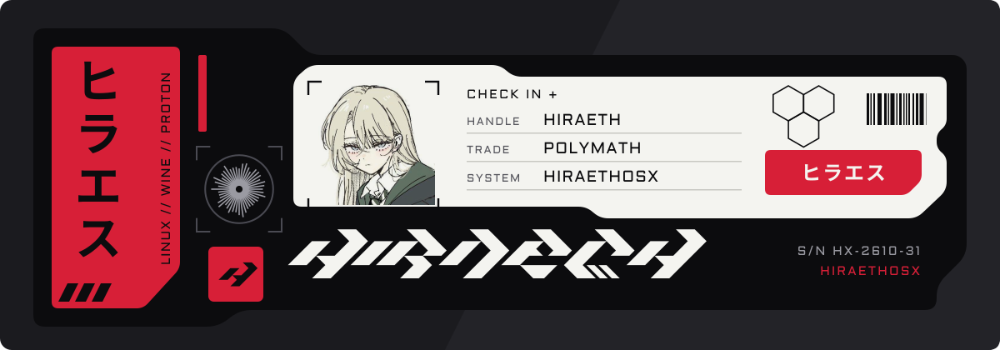
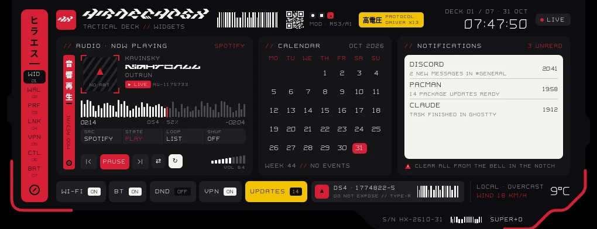

Hi, I'm Hiraeth, an IT administrator in the medical field. 
Outside work I tinker with Linux, Wine and my own desktop.

 

**HiraethOSX** is my own Linux desktop: login and lock screen, polkit prompts, panels and launcher. It started as a fork of [Ambxst](https://github.com/Axenide/Ambxst) and runs on [Quickshell](https://quickshell.org).

<a href="https://github.com/hiraethi/Hiraeth">Older screenshots and videos</a>

 

- **iPad Deck** (WiP): controls my desktop from an iPad.
- **Hiraethi** (WiP): a witchcraft mod for Minecraft with wands, spells and mana.
- **Frontier Companion** (WiP): reads the EVE Frontier client and logs for location, crafting, fitting and bases.
- **Crimson Desert mod manager** (WiP): a native Linux mod manager with FOMOD support.
- **Hiraeth Network** (WiP): a read-only FRITZ!Box app for devices, mesh and Wi-Fi.

 

<em>Hiraeth</em> is Welsh for a longing for a home you can't go back to. Avatar by @yunayuispink.

